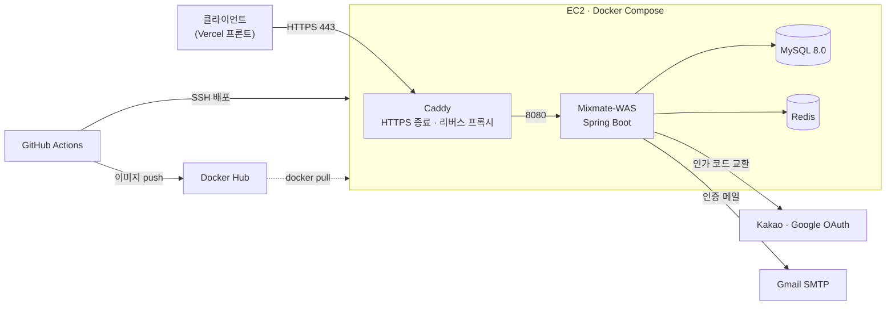

# 아키텍처

> 설계 배경과 트레이드오프: [설계 결정 9 · 인프라](design-decisions.md#9-인프라--단일-호스트-compose-최소-노출)

## 전체 구조

- 모든 외부 요청은 Caddy를 거쳐서만 앱에 도달합니다(앱 포트가 호스트 루프백에만 열려 있음).
- 앱은 세션을 두지 않는 stateless JWT 구조이고, 상태는 MySQL(도메인 데이터)과 Redis(토큰·인증코드)에만 있습니다.
- 프론트는 별도 레포(Vercel)에서 배포되며, 백엔드는 CORS 허용 목록으로만 접근을 허용합니다([CorsConfig](../src/main/java/com/mixmate/config/CorsConfig.java)).

## 컨테이너 구성 (`docker-compose.yml`)

| 서비스 | 이미지 | 외부 노출 | 비고 |
| --- | --- | --- | --- |
| `mixmate-caddy` | `caddy:2-alpine` | 80, 443 | `{$DOMAIN}` 요청을 `mixmate-app:8080`으로 프록시. 인증서는 Caddy가 자동 발급·갱신하며 `caddy_data` 볼륨에 보관 |
| `mixmate-app` | `kdworld/mixmate-was:latest` | `127.0.0.1:8080` | db·redis가 healthy가 된 뒤 기동 |
| `mixmate-db` | `mysql:8.0` | `127.0.0.1:3306` | 데이터는 `./mysql_data`. 접속은 SSH 터널로만 |
| `mixmate-redis` | `redis:latest` | 없음 | compose 내부 네트워크에서만 접근 |

- `caddy_data` 볼륨에 인증서가 들어 있습니다. 지우면 배포마다 재발급하다 Let's Encrypt 발급 제한에 걸릴 수 있습니다.
- 로컬 개발용은 `docker-compose.local.yml`(MySQL·Redis만, 포트를 호스트에 공개)이며 앱은 IDE나 `./gradlew bootRun`으로 띄웁니다.
- 액세스 로그는 Caddy가 `./caddy_logs/access.log`(호스트 기준)에 JSON으로 남깁니다. 읽는 법은 [operations.md](operations.md#액세스-로그-caddy)를 참고하세요.

## CI/CD (`.github/workflows/deploy.yml`)

트리거는 `dev` 브랜치 push입니다.

1. JDK 17로 `./gradlew build -x test` (테스트는 실행하지 않음)
2. Docker Hub 로그인 → `kdworld/mixmate-was:latest` 이미지 빌드·push
3. `docker-compose.yml`, `Caddyfile`을 EC2 `/home/ubuntu`로 SCP (`.env`는 전송하지 않음)
4. SSH로 접속해 `docker pull` → `docker compose down` → `docker compose up -d` → `docker image prune -f`

서버에서 설정을 직접 고치면 다음 배포 때 덮어써집니다. 설정 변경은 항상 레포를 통해 합니다.

## 환경 변수

서버의 `.env`에 둡니다(Git에 포함되지 않음). 값은 문서에 적지 않고 이름과 용도만 정리합니다.

| 구분 | 변수 | 용도 |
| --- | --- | --- |
| 프로필 | `SPRING_PROFILES_ACTIVE` | 기본값 `local` |
| DB | `DB_HOST`, `DB_NAME`, `DB_USER`, `DB_PASSWORD` | MySQL 접속 (`DB_HOST` 기본 `localhost`) |
| Redis | `REDIS_HOST`, `REDIS_PORT` | 기본 `localhost:6379` |
| 메일 | `SMTP_USERNAME`, `SMTP_PASSWORD` | Gmail SMTP(587, STARTTLS) |
| JWT | `JWT_SECRET`, `JWT_ISSUER` | HS256 서명 키, 발급자 |
| 카카오 | `KAKAO_CLIENT_ID`, `KAKAO_CLIENT_SECRET`(선택), `KAKAO_REDIRECT_URI` | 소셜 로그인 |
| 구글 | `GOOGLE_CLIENT_ID`, `GOOGLE_CLIENT_SECRET`, `GOOGLE_REDIRECT_URI` | 소셜 로그인 |
| Caddy | `DOMAIN` | 서비스 도메인 |

로컬 실행은 `application-local.yaml`(gitignore 대상)에 위 값을 두거나 같은 이름의 환경 변수를 설정합니다.

## 주요 설정값

| 항목 | 값 | 위치 / 이유 |
| --- | --- | --- |
| HikariCP 최대 풀 | 20 | 동시 접속이 몰릴 때 기본값 10으로는 커넥션이 고갈됨 ([troubleshooting](troubleshooting.md#1-1-장기-연결이-db-커넥션-풀을-고갈시킨-문제--osiv-원인-규명)) |
| `open-in-view` | `false` | 오래 열려 있는 SSE 응답이 DB 커넥션을 붙잡지 않게 함 |
| 스케줄러 스레드 풀 | 10 | SSE 하트비트가 한 스레드에서 순차 실행되며 막히는 것을 방지 |
| SSE 타임아웃 / 하트비트 | 30분 / 20초 | [group-lifecycle.md](group-lifecycle.md#sse-실시간-상태-푸시) |
| Access / Refresh 토큰 | 1시간 / 7일 | [auth.md](auth.md#토큰) |
| 참여코드 유효 기간 | 7일 | [domain-model.md](domain-model.md#참여코드) |

## 현재 구조의 한계와 개선 후보

1. **단일 EC2 + 앱·DB·Redis 동거**: 한 인스턴스의 CPU·메모리를 서로 나눠 쓰고, 인스턴스가 죽으면 전부 멈춥니다. 확장하려면 DB·Redis를 분리(RDS/ElastiCache 등)한 뒤 앱을 다중화(ALB)해야 합니다.
2. **SSE 구독자가 인스턴스 메모리에만 있음**: [GroupStatusNotifier](../src/main/java/com/mixmate/domain/group/service/GroupStatusNotifier.java)가 emitter를 메모리에 들고 있어, 앱을 여러 대로 늘리면 다른 인스턴스에 붙은 구독자에게 이벤트가 가지 않습니다. 다중화 전에 Redis Pub/Sub 등으로 바꿔야 합니다.
3. **배포가 `down` → `up`**: 재기동 동안 짧은 중단이 생기고 SSE 연결이 끊깁니다. 클라이언트가 재연결하면 현재 상태를 즉시 한 번 받으므로 상태 유실은 없습니다.
4. **이미지 태그가 `latest` 하나**: 문제가 생겨도 이전 이미지로 되돌리기 어렵습니다. 커밋 SHA나 버전 태그를 함께 붙이는 것을 권장합니다. `redis:latest`도 고정되어 있지 않습니다.
5. **배포 파이프라인에서 테스트를 건너뜀**(`-x test`): 깨진 코드가 그대로 배포될 수 있습니다.
6. **`ddl-auto: update`**: 스키마가 마이그레이션 도구 없이 자동 반영됩니다. 컬럼 삭제·타입 변경은 반영되지 않으므로 운영 DB 스키마는 수동 관리가 필요합니다.

이 밖에 운영 중 확인된 설정 불일치와 보안 점검 항목은 [operations.md](operations.md#점검-필요-항목)에 따로 모았습니다.
