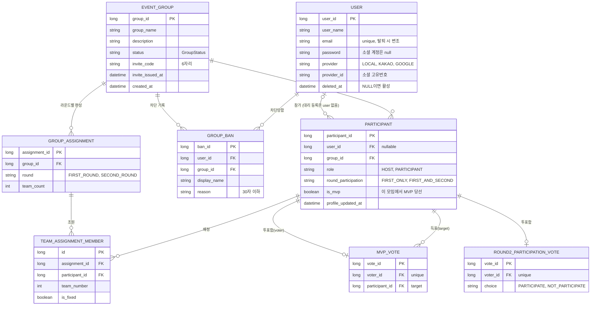

# 도메인 모델

> 설계 배경과 트레이드오프: [설계 결정 3 · 참가자 모델링](design-decisions.md#3-참가자는-모임별-신원이다) · [설계 결정 4 · MVP 누적 횟수](design-decisions.md#4-mvp-누적-횟수--카운터-대신-파생-집계) · [설계 결정 7 · 탈퇴 정책](design-decisions.md#7-탈퇴는-소프트-삭제다)

## ERD

- 그룹 테이블 이름은 `event_group`입니다(`group`이 예약어라서).
- 참가자 프로필(`ParticipantProfile`)은 `participant` 테이블의 임베디드 컬럼입니다: `displayName`, `studentId`, `position`, `major`, `isNew`, `grade`, `gender`, `mbti`, `age`, `instaId`, `bio`, `visibility`.
- `group_assignment`는 (group, round)당 1건, `team_assignment_member`는 (assignment, participant)당 1건, `participant`는 (group, user)당 1건으로 유니크 제약이 걸려 있습니다.

## enum

| enum | 값 |
| --- | --- |
| `GroupStatus` | `RECRUITING`, `BEFORE_FIRST_ROUND`, `FIRST_ROUND`, `VOTING`, `VOTE_CLOSED`, `BEFORE_SECOND_ROUND`, `SECOND_ROUND`, `FINISHED` |
| `Role` | `HOST`, `PARTICIPANT` |
| `Round` | `FIRST_ROUND`, `SECOND_ROUND` |
| `RoundParticipation` | `FIRST_ONLY`, `FIRST_AND_SECOND` |
| `VoteChoice` | `PARTICIPATE`, `NOT_PARTICIPATE` |
| `Visibility` | `PUBLIC`, `PRIVATE` |
| `Position` | `STAFF`, `MEMBER` |
| `Grade` | `FIRST`, `SECOND`, `THIRD`, `FOURTH`, `OTHER` |
| `Gender` | `MALE`, `FEMALE` |
| `Mbti` | 16개 유형 (`isExtrovert()`로 외향/내향 구분) |
| `AssignmentCondition` | `GENDER_BALANCE`, `MBTI_BALANCE`, `GRADE_SPREAD`, `NEWCOMER_SPREAD`, `POSITION_SPREAD` |
| `AuthProvider` | `LOCAL`, `KAKAO`, `GOOGLE` |

## 설계 결정

### 참가자는 "모임마다 새로 생기는 행"이다

`Participant`는 사용자(`User`)와 그룹의 연결이 아니라 **그 모임에서의 신원**입니다. 같은 사용자가 다른 모임에 들어가면 새 행이 생기고, 프로필도 모임마다 따로 입력합니다(최근 프로필 조회 API로 이전 값을 불러올 수 있음). 그래서 조 편성·투표·MVP 기록이 모두 `participant`에 매달립니다.

### 대리 등록 참가자는 `user_id`가 NULL이다

관리자가 오프라인 참가자를 대신 등록하면 로그인 계정이 없으므로 `participant.user_id`가 NULL입니다. 이 행은 (group, user) 유니크 제약에 걸리지 않아(MySQL은 NULL끼리 중복으로 보지 않음) 한 그룹에 여러 명이 들어갈 수 있습니다. 이런 참가자는 본인이 투표할 수 없으므로 관리자가 대신 투표합니다([vote.md](vote.md)). MVP 누적 횟수는 항상 0입니다.

### 탈퇴는 소프트 삭제다

`User.withdraw()`는 `deleted_at`을 기록하고, `email`을 `withdrawn:{userId}:{원래 이메일}`로 바꿉니다. 이메일에 unique 제약이 있어 원래 값을 그대로 두면 같은 이메일로 재가입할 수 없기 때문입니다. `participant` 등 이력은 그대로 남깁니다(조 편성·투표 기록이 깨지지 않도록). 탈퇴한 계정은 로그인과 JWT 인증이 모두 거부됩니다. 자세한 흐름은 [auth.md](auth.md#회원-탈퇴).

보관 기간이 지난 계정을 익명화·하드 삭제하는 배치는 아직 없습니다. 수동으로 지워야 할 때의 절차는 [operations.md](operations.md#회원-데이터-수동-삭제)에 있습니다.

### MVP 누적 횟수는 카운터가 아니라 집계로 구한다

MVP로 뽑히면 해당 모임의 `participant.is_mvp`가 `true`가 되고(투표가 마감되는 시점에 한 번), 계정의 누적 횟수는 `is_mvp = true`인 행의 개수를 세서 구합니다(`countByUserAndIsMvpTrue`). `User`에 카운터 컬럼을 두지 않은 이유는, 증가 로직을 빼먹었을 때 실제 데이터와 어긋나는 것을 구조적으로 막기 위해서입니다. 자세한 내용은 [vote.md](vote.md#mvp-누적-횟수).

### 참여코드

- 6자리, 문자 집합은 `ABCDEFGHJKLMNPQRSTUVWXYZ23456789`(헷갈리는 `0/O`, `1/I/l` 제외), `SecureRandom`으로 생성. 중복은 저장 전에 확인합니다.
- 유효 기간은 **발급 시점부터 7일**(`Group.INVITE_VALID_DAYS`).
- 초대 링크는 이 참여코드를 실어 보내는 URL이며, 링크 주소 자체는 프론트에서 조립합니다. 그래서 링크와 코드의 수명은 항상 같습니다.
- 재발급(`POST /groups/{groupId}/invitation/reissue`)하면 기존 코드와 링크가 즉시 무효가 되고 7일이 다시 시작됩니다. 모집 중일 때만 조회·재발급할 수 있습니다.
