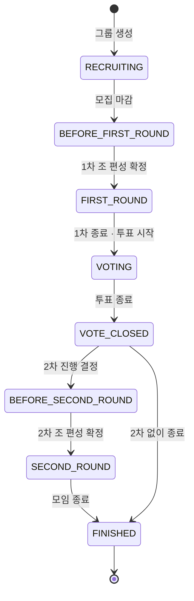

# 그룹 생명주기

> 설계 배경과 트레이드오프: [설계 결정 6 · 상태 머신 · 멱등 전이 · 커밋 후 푸시](design-decisions.md#6-상태-머신--멱등-전이--커밋-후-푸시)

그룹은 8단계 상태 머신으로 진행됩니다. 상태 판정은 [GroupStatus](../src/main/java/com/mixmate/domain/group/enums/GroupStatus.java)에, 전이는 [Group](../src/main/java/com/mixmate/domain/group/entity/Group.java)의 메서드에 있습니다.

## 상태 전이

## 전이 API와 조건

모든 전이는 **HOST(관리자)** 만 호출할 수 있습니다.

| 전이 | API | 조건 |
| --- | --- | --- |
| `RECRUITING` → `BEFORE_FIRST_ROUND` | `POST /api/v1/groups/{groupId}/close-recruiting` | 참가자 **4명 이상** (조당 최소 2명 × 최소 2개 조) |
| `BEFORE_FIRST_ROUND` → `FIRST_ROUND` | `POST /api/v1/groups/{groupId}/rounds/FIRST_ROUND/teams/confirm` | 조 편성 실행 이력이 있어야 함. 이미 시작된 라운드에 다시 호출하면 아무 일도 하지 않고 성공 |
| `FIRST_ROUND` → `VOTING` | `POST /api/v1/groups/{groupId}/voting` | |
| `VOTING` → `VOTE_CLOSED` | `POST /api/v1/groups/{groupId}/votes/finish` | 미투표자는 2차 불참으로 자동 처리, MVP 당선자 확정 ([vote.md](vote.md)) |
| `VOTE_CLOSED` → `BEFORE_SECOND_ROUND` | `POST /api/v1/groups/{groupId}/second-round` | 2차 참여 인원 **8명 이상** |
| `BEFORE_SECOND_ROUND` → `SECOND_ROUND` | `POST /api/v1/groups/{groupId}/rounds/SECOND_ROUND/teams/confirm` | |
| `VOTE_CLOSED`/`SECOND_ROUND` → `FINISHED` | `POST /api/v1/groups/{groupId}/finish` | 되돌릴 수 없음. 종료하면 이 그룹의 차단 기록도 함께 삭제됨. 이미 종료된 그룹에 다시 호출해도 204 |

- 조 편성 **실행**(`.../teams/generate`)은 상태를 바꾸지 않고, `BEFORE_FIRST_ROUND`/`BEFORE_SECOND_ROUND`에서만 가능합니다. 확정 전에는 몇 번이든 다시 실행할 수 있습니다([assignment.md](assignment.md)).
- 상태 전이 API는 중복 호출을 **멱등**으로 처리합니다. 같은 요청이 두 번 와도 오류 없이 성공으로 응답합니다.
- 최소 인원 상수는 [GroupService](../src/main/java/com/mixmate/domain/group/service/GroupService.java)의 `MIN_ASSIGNABLE_PARTICIPANTS`(4), `MIN_SECOND_ROUND_PARTICIPANTS`(8)입니다.

## 상태에 따른 조회 규칙

- **1차 참가자 목록**: 조 편성이 끝난 뒤부터 조회할 수 있습니다. 관리자는 참가자를 추가·삭제해야 하므로 편성 전에도 조회할 수 있습니다.
- **2차 참가자 목록**: 2차 참석자만 포함되며 2차 진행이 확정된 뒤부터 조회할 수 있습니다. 2차에 참여하지 않은 참가자는 조회할 수 없습니다.
- **참가자 추가·삭제**: 1차가 시작되면 명단이 고정되므로 그 전에만 가능합니다. 명단이 바뀌면 이미 실행해 둔 조 편성은 함께 초기화됩니다.
- **참여코드/초대 링크**: 모집 중(`RECRUITING`)일 때만 조회·재발급할 수 있고, 모집이 마감된 그룹은 입장도 거부됩니다.

## SSE 실시간 상태 푸시

참가자 화면이 그룹 상태 변화(예: 투표 시작)를 폴링 없이 받도록 SSE를 사용합니다.

- 구독: `GET /api/v1/groups/{groupId}/status/stream` (`text/event-stream`). 그 그룹의 참가자만 구독할 수 있습니다.
- 연결 직후 **현재 상태를 한 번** 보냅니다. 연결이 끊겼다가 다시 붙는 사이에 놓친 변경을 메워 주기 때문에, 클라이언트는 재연결만 하면 됩니다.
- 이벤트 이름은 `status`이고 데이터는 `{ groupId, status }`입니다.
- 상태가 바뀌면 `GroupStatusChangedEvent`가 발행되고, **트랜잭션 커밋 이후**(`AFTER_COMMIT`)에 구독자에게 전송됩니다. 롤백된 변경은 푸시되지 않습니다.
- 20초마다 `ping` 주석을 보내 연결을 유지합니다. 클라이언트 라이브러리의 유휴 타임아웃(가장 짧은 것이 45초)보다 짧아야 멀쩡한 연결이 끊기지 않습니다.
- 연결 타임아웃은 30분입니다. 만료되면 클라이언트가 다시 구독합니다.
- 구독자 레지스트리는 인스턴스 메모리에 있으므로 앱을 여러 대로 늘릴 때는 구조 변경이 필요합니다([architecture.md](architecture.md#현재-구조의-한계와-개선-후보)).
- SSE 연결이 끝나면 같은 요청이 `ASYNC`로 재디스패치되는데 이때는 SecurityContext가 비어 있어 인증에 실패합니다. 응답은 이미 나간 뒤라 처리할 수 없고 에러 로그만 쌓이므로, 해당 경로의 `ASYNC` 디스패치는 인증 재검사에서 제외했습니다([SecurityConfig](../src/main/java/com/mixmate/config/SecurityConfig.java)).
- SSE 구독 중에는 DB 커넥션을 붙잡지 않아야 합니다. 이를 위해 `open-in-view`를 끈 경위는 [troubleshooting.md](troubleshooting.md#1-1-장기-연결이-db-커넥션-풀을-고갈시킨-문제--osiv-원인-규명)에 있습니다.
