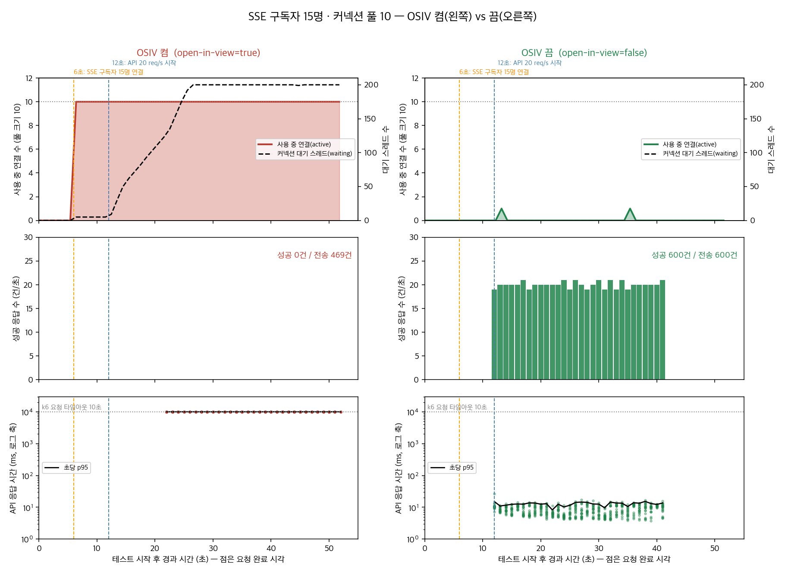
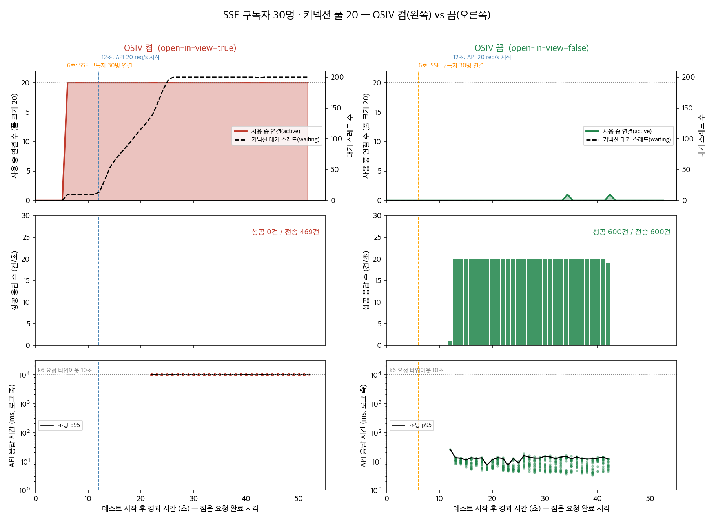

# 부하 테스트

두 가지를 했습니다. ① SSE 도입 직후 겪은 **커넥션 풀 고갈 장애(OSIV)를 로컬에서 재현**해 원인과 해결 효과를 수치·그래프로 확인했고, ② 현재 운영 설정으로 읽기 API의 **처리 한계를 단계적으로 탐색**했습니다. 그리고 측정 도중 스스로 만든 **측정 오류를 찾아 고친 과정**도 기록했습니다(5장).

> **이 문서의 수치는 2026-11-19에 한 대의 맥북에서 측정한 값입니다. 운영 서버(EC2)의 성능이 아닙니다.** 운영 서버 대상 테스트는 아직 하지 않았고, 날짜와 시간대를 따로 정한 뒤 진행합니다(7장).

## 한눈에 보기

| | 결과 |
| --- | --- |
| **OSIV 재현** | OSIV를 켠 상태에서 SSE 구독자 수가 커넥션 풀 크기 이상이 되면 **SSE와 무관한 일반 API의 성공률이 100% → 0%** 로 떨어졌습니다. OSIV를 끄면 구독자 30명에서도 **100% 성공, p95 약 12ms**. 풀을 10 → 20으로 늘린 것(1차 완화)은 무너지는 지점을 15명에서 30명으로 **옮기기만** 했습니다. |
| **용량 테스트** | 현재 운영 설정(OSIV off, 풀 20)에서 읽기 API는 이 머신에서 **3,000 TPS까지 오류 0%, p95 2.7ms** 로 포화 지점을 찾지 못했습니다. 이는 앱·DB·k6가 한 머신에 있고 데이터가 작은 로컬 결과라 EC2의 한계를 말해주지 않습니다. |
| **측정 검증** | 측정 오류 7건(대조군 동시 실패, 대기 스레드 이중 집계, CPU 측정 방식, 그래프 시간축 등)을 발견해 고쳤고, 두 번 독립적으로 돌린 OSIV 12케이스의 판정이 **12/12 일치**했습니다. |

## 1. 목적과 가정

**가정과 측정을 구분합니다.** 아래 값은 실제 사용 통계가 아니라 *테스트 설계용 가정*입니다.

- **SSE 구독자 수(15명·30명)**: 풀 크기(10·20)와 비교하기 위해 정한 값입니다. 실제 동시 구독자 수는 아직 모릅니다.
- **API 부하(초당 20건)·용량 테스트의 TPS**: 사용자 수에서 역산한 값이 아닙니다. 실사용 통계를 얻을 수 있는 Caddy 액세스 로그가 아직 배포 전이라, 목표 TPS를 근거 있게 계산할 수 없었습니다. 그래서 **목표를 정해 통과/실패를 보는 대신 단계적으로 올려 한계를 찾는 방식**으로 설계했습니다.
- **통과 기준(용량 테스트)**: p95 200ms 미만, 오류율 1% 미만. 이 프로젝트에서 정한 기준이며 k6 측 값(클라이언트 관점)입니다.

## 2. 환경과 한계

| 항목 | 값 |
| --- | --- |
| 측정 일시 | 2026-11-19 14:42 KST 시작 |
| OS | macOS 27.0.1 (arm64) |
| 하드웨어 | Mac16,12, 논리 코어 10개, 메모리 16GB |
| JDK(실행) | openjdk version "21.0.9" 2025-10-21 LTS |
| k6 | k6 v2.4.0 (commit/devel, go1.27.4, darwin/arm64) |
| MySQL | 9.4.0 (Homebrew, 운영은 mysql:8.0) |
| Redis | v=8.10.0 |
| 앱 | Spring Boot 3.5.3, java -Xms512m -Xmx1g -jar (bootJar) |
| Tomcat 워커 스레드 | 기본값(200), Hikari connectionTimeout: 기본값(30s) |
| 부하 발생기·앱·MySQL·Redis | 같은 머신(localhost) |
| 전원 | 배터리 구동 (저전력 모드 꺼짐), 맥북 덮개 열림, caffeinate -i 로 유휴 잠자기 방지 |
| 측정 순서 | OSIV 12케이스(2회) → 용량 테스트 6시나리오 → OSIV 시계열 4케이스 |

- 부하 발생기(k6)·앱·MySQL·Redis가 **한 머신(localhost)** 에서 돌아 서로 자원을 나눠 씁니다. 운영 구조(앱·DB·Redis가 한 EC2)와 비슷하지만 사양이 다릅니다.
- DB는 임시로 띄운 MySQL 9.4입니다(운영은 8.0). 커넥션 점유 메커니즘은 앱 쪽 동작이라 DB 버전과 무관하지만, 쿼리 시간은 다를 수 있습니다.
- 운영·개발 DB, `.env`, 실제 서비스는 건드리지 않았습니다. 임시 MySQL·Redis의 포트를 따로 쓰고 접속 정보는 환경 변수로 덮어썼습니다.
- 측정 중에는 로깅 비용이 섞이지 않도록 `org.springframework.security` 로그 레벨을 INFO로, `show-sql`을 끄고 돌렸습니다(현재 기본 설정은 DEBUG / true).
- 케이스당 1회 측정입니다(OSIV 실험은 전체를 2회 반복). 효과가 이분법적(0% vs 100%)이라 1회로도 판정에는 충분하지만, 평균·분산을 말할 만큼의 반복은 아닙니다.

---

## 3. 실험 1 — OSIV로 인한 커넥션 풀 고갈 재현

### 가설

SSE 구독 요청은 응답이 끝나지 않는 동안 요청이 계속 열려 있다. `open-in-view=true`이면 영속성 컨텍스트(와 DB 커넥션)가 요청 전체에 묶여서, **동시 구독자 수만큼 커넥션이 반납되지 않고**, 구독자가 풀 크기 이상이면 SSE와 무관한 요청도 커넥션을 못 받는다. `false`로 끄면 커넥션은 `@Transactional` 종료 시점에 반납되어 구독자 수와 무관해진다. ([원인 분석](../troubleshooting.md#1-1-장기-연결이-db-커넥션-풀을-고갈시킨-문제--osiv-원인-규명))

### 시나리오

변수는 OSIV 여부, 풀 크기, SSE 구독자 수 세 가지이고 나머지는 모두 고정했습니다.

| 시간 | 동작 |
| --- | --- |
| 0~6초 | 워밍업 (초당 5건) |
| 6초 | SSE 구독자 N명이 `GET /groups/{id}/status/stream`에 연결하고 38초 동안 유지 |
| 12~42초 | **일반 API** `GET /groups?scope=me&state=active`를 초당 20건 (k6 요청 타임아웃 10초) |

| 설정 | OSIV | 풀 크기 | 의미 |
| --- | --- | --- | --- |
| A | on | 10 | 장애 당시 설정 |
| B | on | 20 | 1차 완화(풀 증설) 이후 |
| C | off | 20 | 현재 운영 설정 |
| D | off | 10 | A와 **OSIV만 다름** — 가장 깨끗한 비교 |

설정마다 SSE 구독자를 0 / 15 / 30명으로 바꿔 총 12케이스를 돌렸고, 케이스마다 앱을 새로 띄웠습니다. 성공률은 *전송된* 일반 API 요청 중 10초 안에 200을 받은 비율입니다.

### 결과

| 설정 | OSIV | 풀 | SSE 구독자 | 전송한 API 요청 | 성공률 | 평균 | p95 | p99 | 미전송(dropped) | 커넥션 대기 스레드 |
| --- | --- | --- | --- | --- | --- | --- | --- | --- | --- | --- |
| A | on | 10 | 0 | 601 | 100.0% | 8ms | 13ms | 15ms | 0 | 0 |
| A | on | 10 | 15 | 468 | 0.0% | 10.0s | 10.0s | 10.0s | 132 | 200 |
| A | on | 10 | 30 | 469 | 0.0% | 10.0s | 10.0s | 10.0s | 132 | 200 |
| B | on | 20 | 0 | 601 | 100.0% | 8ms | 13ms | 15ms | 0 | 0 |
| B | on | 20 | 15 | 601 | 100.0% | 8ms | 13ms | 16ms | 0 | 0 |
| B | on | 20 | 30 | 468 | 0.0% | 10.0s | 10.0s | 10.0s | 132 | 200 |
| C | off | 20 | 0 | 601 | 100.0% | 9ms | 14ms | 17ms | 0 | 0 |
| C | off | 20 | 15 | 601 | 100.0% | 8ms | 13ms | 15ms | 0 | 0 |
| C | off | 20 | 30 | 600 | 100.0% | 8ms | 12ms | 14ms | 0 | 0 |
| D | off | 10 | 0 | 601 | 100.0% | 9ms | 14ms | 16ms | 0 | 0 |
| D | off | 10 | 15 | 601 | 100.0% | 9ms | 14ms | 16ms | 0 | 0 |
| D | off | 10 | 30 | 601 | 100.0% | 7ms | 12ms | 14ms | 0 | 0 |

- 구독자 **0명**은 네 설정 모두 100% / p95 12~14ms로 같은 수준입니다 → **OSIV를 껐다고 성능이 나빠지지 않았고**, 실패는 구독자 때문에 생긴 것입니다.
- **A**(OSIV on, 풀 10): 구독자 15명에서 0%. **B**(OSIV on, 풀 20): 15명은 버텼지만 30명에서 0%. 즉 **구독자 수가 풀 크기 이상이 되는 순간** 무너집니다. 풀 증설은 한계선을 옮겼을 뿐입니다.
- **C·D**(OSIV off): 풀이 10이든 20이든, 구독자가 30명이든 100% 성공합니다.
- `미전송(dropped)`은 서버가 응답하지 않아 k6의 VU가 10초씩 묶인 탓에 k6가 요청을 보내지 못한 건수입니다(k6 쪽 한계로 해석, 추정). 이를 실패로 셈해도 해당 케이스는 0/600이라 결론은 같습니다.
- `커넥션 대기 스레드`는 부하 중간(약 30초 시점)에 `jcmd Thread.print`로 센 값입니다. 200은 Tomcat 워커 스레드 기본 상한이라, 요청 스레드가 **전부** 커넥션을 기다리고 있다는 뜻입니다.

**시간에 따른 변화** (HikariCP 풀 상태는 JMX로 1초마다 수집, 왼쪽 OSIV 켬 / 오른쪽 끔)





- OSIV 켬: 구독자가 연결되는 **6초에 사용 중 연결이 풀 크기로 고정**되고(오른쪽 축의 대기 스레드는 이후 200까지 상승), 일반 API는 성공 0건이며 응답은 전부 10초 타임아웃으로 끝납니다.
- OSIV 끔: 구독자가 같은 시각에 연결돼도 사용 중 연결은 0~1에 머물고, 600건 모두 약 12ms에 성공합니다.

**서버 로그 증거** (앱 로그 원본에서 발췌, 전체는 `results/2026-11-19/evidence/`)

```text
## A-h15 — OSIV 켬
커넥션 획득 실패 로그 건수: 732
첫 번째 로그:
ERROR 14089 --- [Mixmate-WAS] [nio-8080-exec-8] o.h.engine.jdbc.spi.SqlExceptionHelper   : HikariPool-1 - Connection is not available, request timed out after 30003ms (total=10, active=10, idle=0, waiting=198)
waiting 최댓값: 199

## B-h30 — OSIV 켬
커넥션 획득 실패 로그 건수: 760
첫 번째 로그:
ERROR 15247 --- [Mixmate-WAS] [io-8080-exec-24] o.h.engine.jdbc.spi.SqlExceptionHelper   : HikariPool-1 - Connection is not available, request timed out after 30005ms (total=20, active=20, idle=0, waiting=198)
waiting 최댓값: 199

## C-h30 — OSIV 끔
커넥션 획득 실패 로그 건수: 0
ERROR 행 수: 5  (전부 그레이스풀 셧다운 시작 30초 뒤 시각 = 앱 종료 때 SSE 연결이 강제로 정리되며 남긴 로그. 부하 중에는 0건)
2026-11-19T14:53:15.118+09:00 INFO 15932 --- [Mixmate-WAS] [ionShutdownHook] o.s.b.w.e.tomcat.GracefulShutdown        : Commencing graceful shutdown. Waiting for active requests to complete
org.springframework.web.context.request.async.AsyncRequestTimeoutException: null
org.springframework.web.context.request.async.AsyncRequestTimeoutException: null

## D-h30 — OSIV 끔
커넥션 획득 실패 로그 건수: 0
ERROR 행 수: 5  (전부 그레이스풀 셧다운 시작 30초 뒤 시각 = 앱 종료 때 SSE 연결이 강제로 정리되며 남긴 로그. 부하 중에는 0건)
2026-11-19T14:56:48.732+09:00 INFO 16631 --- [Mixmate-WAS] [ionShutdownHook] o.s.b.w.e.tomcat.GracefulShutdown        : Commencing graceful shutdown. Waiting for active requests to complete
org.springframework.web.context.request.async.AsyncRequestTimeoutException: null
org.springframework.web.context.request.async.AsyncRequestTimeoutException: null
```

### 해석과 검증 범위

- **확인한 것**: 이 코드와 설정에서 OSIV를 켜면 SSE 구독자가 커넥션을 구독 내내 점유하고, 구독자 수가 풀 크기 이상일 때 일반 API까지 전부 실패한다는 **메커니즘**. 끄면 점유가 사라진다는 것. 풀 증설만으로는 해결되지 않는다는 것.
- **확인하지 못한 것**: 운영 EC2에서 **몇 명**에서 무너지는지(풀 크기가 임계 인원을 정하므로 같은 구조지만 값은 환경에 따라 다릅니다), 실제 동시 구독자 수.
- 장애 당시의 환경을 그대로 되살린 것이 아니라 **원인 메커니즘을 격리해 재현**한 실험입니다.

### 부수 발견: 앱 종료 때 SSE 연결이 30초를 붙잡는다

OSIV 끈 케이스 로그의 ERROR 5줄은 모두 앱 종료를 시작한 **30초 뒤**(그레이스풀 셧다운 제한 시간)에 찍혔고 부하 중에는 0건이었습니다. 열려 있는 SSE 요청이 종료를 30초 지연시키다가 `AsyncRequestTimeoutException`으로 강제 정리되고, 전역 핸들러가 이를 "처리되지 않은 예외" ERROR로 남깁니다. 배포(`docker compose down`)마다 같은 일이 일어날 수 있어 [점검 필요 항목](../operations.md#점검-필요-항목)에 올렸습니다.

---

## 4. 실험 2 — 용량 테스트

### 시나리오

현재 운영 설정(OSIV off, 풀 20)으로 앱 1개를 띄워 두고 아래를 **차례로** 실행했습니다(시나리오 사이 20초 냉각). 요청 발생률(arrival-rate)로 부하를 정의하며, 여기서 TPS는 초당 API 요청 수(req/s)입니다.

| 시나리오 | 부하 | 목적 |
| --- | --- | --- |
| smoke | 2 TPS, 15초 | 시나리오 동작 확인 |
| baseline | 10 TPS, 1분 | 평상시 기준선 |
| load | 1분 동안 10 → 100 TPS, 이후 100 TPS로 2분 유지 | 지속 부하 |
| spike | 10초 동안 10 → 150 TPS, 이후 150 TPS로 1분 유지 | 순간 집중 |
| stress | 50 → 400 TPS까지 30초 단위로 50씩 증가 | 한계 접근 |
| breakpoint | 500 → 3,000 TPS까지 30초 단위로 500씩 증가 | 포화 지점 탐색 |

- 요청 비율: 내 그룹 목록 70%, 그룹 상세 30% (읽기 API만. 쓰기는 데이터가 쌓이므로 제외).
- 데이터: 테스트 계정 1개, 그룹 10개. **데이터가 작아 쿼리가 가볍습니다.**

### 결과

| 시나리오 | 설정 부하 | 총 요청 | k6 p95 | k6 p99 | 최대 | 오류율 | 미전송(dropped) | 앱 CPU 최대 | MySQL CPU 최대 | k6 CPU 최대 | Hikari active 최대 / waiting 최대 (풀 20) |
| --- | --- | --- | --- | --- | --- | --- | --- | --- | --- | --- | --- |
| smoke | 2 TPS, 15초 | 30 | 59.6ms | 227.7ms | 288.6ms | 0.00% | 0 | 0.4코어 (4%) | 0.0코어 (0%) | 0.0코어 (0%) | 0 / 0 |
| baseline | 10 TPS, 1분 | 600 | 23.1ms | 26.7ms | 59.0ms | 0.00% | 0 | 0.3코어 (3%) | 0.0코어 (0%) | 0.0코어 (0%) | 1 / 0 |
| load | 1분 동안 10→100 TPS, 이후 100 TPS로 2분 유지 | 15300 | 5.3ms | 8.6ms | 57.6ms | 0.00% | 0 | 0.3코어 (3%) | 0.1코어 (1%) | 0.0코어 (0%) | 1 / 0 |
| spike | 10초 동안 10→150 TPS, 이후 150 TPS로 1분 유지 | 9800 | 4.0ms | 5.3ms | 59.8ms | 0.00% | 0 | 0.2코어 (2%) | 0.1코어 (1%) | 0.1코어 (1%) | 1 / 0 |
| stress | 50→400 TPS까지 30초 단위로 50씩 증가 | 53125 | 4.0ms | 6.5ms | 60.9ms | 0.00% | 0 | 0.2코어 (2%) | 0.2코어 (2%) | 0.1코어 (1%) | 1 / 0 |
| breakpoint | 500→3000 TPS까지 30초 단위로 500씩 증가 | 308745 | 2.7ms | 3.7ms | 111.5ms | 0.00% | 0 | 3.1코어 (31%) | 2.3코어 (23%) | 0.5코어 (5%) | 9 / 0 |

지표 정의:
- **k6 p95**: 클라이언트(k6) 관점의 응답 시간이며 localhost라 네트워크 구간은 사실상 0입니다. 서버 측 p95는 Actuator 같은 서버 지표가 없어 따로 수집하지 못했습니다.
- **CPU**: 누적 CPU 시간의 증가량을 2초마다 계산한 최댓값이며 *코어 환산(전체 코어 10개 대비 %)* 입니다.
- **Hikari**: JMX로 1초마다 읽은 최댓값입니다.

### 해석

- 3,000 TPS까지 **오류 0%**, p95 2.7ms, 최대 111.5ms. 이때 앱 3.1코어·MySQL 2.3코어·k6 0.5코어를 쓰고 Hikari는 풀 20 중 최대 9만 사용했습니다. **어느 자원도 포화되지 않았고**(k6가 한계가 아니었음, 미전송 0건) 포화 지점을 찾지 못했습니다.
- 낮은 부하가 더 느린 것(smoke 59.6ms → baseline 23.1ms → load 5.3ms)은 부하와 무관하게 **JVM이 데워지는 효과**로 보입니다(같은 JVM으로 시나리오를 연달아 실행. 추정). baseline이 load보다 느리다고 읽으면 안 됩니다.
- 읽기 경로의 앱·DB 로직은 이 규모에서 병목이 아니고, 한계는 **호스트 자원(인스턴스 사양)** 에서 결정될 가능성이 큽니다. 그래서 EC2 대상 측정이 다음 단계입니다.

### 검증 범위 (이 결과로 말할 수 없는 것)

- **EC2의 처리량이 아닙니다.** 이 맥북(10코어·16GB)과 운영 인스턴스는 사양이 다릅니다.
- **3,000 TPS를 오래 유지한 결과가 아닙니다.** 각 단계를 30초씩만 유지했고 가장 긴 시나리오도 3분입니다. 장시간 안정성(메모리 누수, GC, 커넥션 누수)은 검증하지 않았습니다.
- 데이터가 작고 읽기 API만 대상이라, 쓰기·조 편성 같은 무거운 연산의 한계는 알 수 없습니다.
- 목표 TPS를 실사용 통계에서 역산하지 않았습니다(1장).

---

## 5. 측정을 신뢰할 수 있게 만든 과정

측정 도구가 틀리면 결과가 맞아도 소용이 없습니다. 이 실험에서 **내가 만든 측정 오류를 7건 발견해 고쳤습니다.** 발견한 계기는 모두 "결과가 이상하다"는 감각이었고, 그때마다 *무엇이 불가능한 값인지*를 먼저 물었습니다.

| # | 발견 | 의심한 근거 | 원인 | 수정 |
| --- | --- | --- | --- | --- |
| 1 | 시드(테스트 데이터) 생성 실패로 모든 요청이 401 | **OSIV를 켠 쪽과 끈 쪽이 똑같이 0%** 였고 평균 3~4ms로 비정상적으로 빨랐음. 당시 출력: A 601건 0.0% 평균 3ms / D 601건 0.0% 평균 4ms (원본은 폐기) | macOS 기본 bash 3.2가 JSON의 중괄호를 브레이스 확장해 요청이 3조각으로 쪼개짐 | JSON을 변수로 먼저 만들어 전달, **시드 실패 시 즉시 중단**(`seed.env` 가 비면 실행 거부), SSE 구독 스모크 추가 |
| 2 | "커넥션 대기 스레드 400" | Tomcat 워커 스레드 상한이 200인데 400은 **불가능한 값** | `jcmd` 스택에서 스레드가 아니라 `HikariPool.getConnection` 프레임을 셌고, 한 스레드가 프레임 2개를 가짐 | 스레드 블록 단위로 집계(awk) → 재측정 값 200(상한과 일치) |
| 3 | "OSIV를 끈 쪽이 멀쩡한 건 SSE가 안 붙어서 아닌가?" | 대조군이 의미 있으려면 구독자가 실제로 붙어 있어야 함 | (가설) | 반증: 구독자 케이스의 k6 최대 응답 시간이 **38.0초**(구독 유지), 구독자 0명은 0.3초. 전체 요청 수도 구독자 수에 거의 비례해 증가(0명 633건 → 15명 647건 → 30명 662건). JMX로 **연결은 붙어 있는데 active는 0**임을 확인 |
| 4 | OSIV 끈 쪽 로그에 ERROR | 부하 중 오류가 없는데 로그에는 있음 | 앱을 내릴 때 SSE 연결이 정리되며 남긴 로그 | 로그 시각이 모두 **종료 시작 30초 뒤**임을 확인(부하 중 0건). 3장 부수 발견으로 기록 |
| 5 | CPU 측정 방식 | `ps %cpu`는 순간값이 아니라 평활값이라 **짧은 부하 변화를 놓칠 수 있음** | macOS `ps`의 %cpu는 평활된 값 | **누적 CPU 시간의 증가량**으로 계산하는 샘플러(`cpusampler.py`)로 교체. 낮은 부하 구간에서는 교체 전후 값이 비슷했지만(예: stress 앱, 전체 대비 4% → 2%), 고부하(breakpoint)에서 3.1코어를 포착 |
| 6 | Hikari 풀 상태가 30초 샘플 | 30초마다 한 번 찍히는 순간값이라 400 TPS에서 active 0으로 보임 | DEBUG 로그의 풀 통계는 30초 주기 | JMX로 **1초 간격** 수집(`HikariSampler.java`) → baseline~stress에서 최대 1, breakpoint에서 9 |
| 7 | 시계열 그래프에서 SSE 연결 **전에** 대기 스레드가 오름 | 원인이 결과보다 늦을 수 없음 | 시간 원점을 "첫 요청 완료 시각"으로 잡았는데, 실패 요청은 10초 타임아웃으로 끝나 **완료가 10초 늦음** | 워밍업 시나리오(항상 즉시 성공)의 첫 완료를 원점으로 변경, 대기 스레드를 별도 축으로 분리 |

이 밖에 환경 문제 두 건도 있었습니다. 임시 MySQL이 기동하지 않았고(macOS 유닉스 소켓 경로 길이 제한 103자), 스크립트의 연관 배열(`declare -A`)이 bash 3.2에서 동작하지 않았습니다(사전 검토에서 발견, `case`로 대체).

### 재현성

OSIV 12케이스를 **서로 다른 두 벌의 스크립트**(1차: 임시 스크립트, 2차: 이 레포에 커밋된 스크립트)로 각각 처음부터 돌렸고, 성공/실패 판정이 **12/12** 일치했습니다. 수치는 완전히 같지 않지만(성공한 9케이스의 p95 차이: 평균 1.6ms, 최대 3.4ms / 타임아웃 케이스는 둘 다 10초 근처) 결론을 바꾸는 차이는 없었습니다.

| 케이스 | 1차 (임시 스크립트) 성공률 / p95 | 2차 (레포 스크립트) 성공률 / p95 | 판정 |
| --- | --- | --- | --- |
| A-h0 | 100.0% / 13.8ms | 100.0% / 12.5ms | 일치 |
| A-h15 | 0.0% / 10.0s | 0.0% / 10.0s | 일치 |
| A-h30 | 0.0% / 10.0s | 0.0% / 10.0s | 일치 |
| B-h0 | 100.0% / 14.5ms | 100.0% / 13.0ms | 일치 |
| B-h15 | 100.0% / 14.0ms | 100.0% / 13.0ms | 일치 |
| B-h30 | 0.0% / 10.0s | 0.0% / 10.0s | 일치 |
| C-h0 | 100.0% / 13.8ms | 100.0% / 14.3ms | 일치 |
| C-h15 | 100.0% / 14.8ms | 100.0% / 12.7ms | 일치 |
| C-h30 | 100.0% / 10.4ms | 100.0% / 12.0ms | 일치 |
| D-h0 | 100.0% / 14.0ms | 100.0% / 13.7ms | 일치 |
| D-h15 | 100.0% / 10.9ms | 100.0% / 14.0ms | 일치 |
| D-h30 | 100.0% / 15.4ms | 100.0% / 12.0ms | 일치 |

---

## 6. 재현 방법

사전 준비: JDK 17+, `brew install k6 mysql redis`. 임시 MySQL(3307)·Redis(6380)를 따로 띄우므로 개발·운영 환경에 영향이 없고, 데이터는 임시 폴더(`$TMPDIR/mixmate-loadtest`, `LT_WORK`로 변경 가능)에만 쌓입니다.

```bash
# OSIV 실험 — 빠른 확인(A와 D, 구독자 15명, 약 3분)
CASES="A D" HOLDERS="15" docs/loadtest/scripts/run_matrix.sh

# OSIV 실험 — 전체 12케이스 (약 15분)
docs/loadtest/scripts/run_matrix.sh

# 용량 테스트 — 전체(약 15분) 또는 일부
docs/loadtest/scripts/run_capacity.sh
docs/loadtest/scripts/run_capacity.sh smoke baseline

# 시계열 수집 + 그래프 (케이스 이름, OSIV, 풀 크기, 구독자 수)
docs/loadtest/scripts/run_timeseries.sh A-h15 true 10 15
docs/loadtest/scripts/run_timeseries.sh D-h15 false 10 15
python3 docs/loadtest/scripts/charts.py "$TMPDIR/mixmate-loadtest/results" docs/loadtest/results/charts

# 임시 MySQL·Redis 종료
docs/loadtest/scripts/infra.sh stop
```

- 측정하는 동안 **맥북 덮개를 닫지 마세요**(잠자기에 들어가면 측정이 깨집니다). 부하 발생기와 앱이 같은 머신이므로 다른 무거운 작업도 피합니다.
- k6 요약 JSON에는 `setup()` 반환값, 즉 **로그인 토큰이 담깁니다.** 스크립트가 `scrub_token.py`로 자동 제거하지만, 결과를 직접 커밋할 때는 토큰이 남아 있지 않은지(`grep -r eyJ`) 확인하세요.
- 스크립트는 `BASE_URL`을 읽으므로(`osiv.js`, `capacity.js`) 같은 시나리오를 다른 서버에 겨눌 수 있지만, **운영 서버에는 합의 없이 실행하지 않습니다**(7장).

## 7. 다음 단계

1. **운영(EC2) 대상 용량 테스트**: 날짜·시간대를 정해 팀에 알린 뒤, 사용자가 가장 적은 시간에 읽기 API만 낮은 강도부터. `User-Agent: mixmate-loadtest`로 실사용 로그와 구분하고, 테스트 계정은 끝난 뒤 지웁니다. 이를 위한 운영 모드 스크립트(앱을 띄우지 않고 `BASE_URL`만 겨누는 버전)가 필요합니다.
2. **서버 측 지표 도입**: Actuator + Micrometer + Prometheus + Grafana. 서버 측 p95, HikariCP 풀 그래프, JVM·CPU를 상시 볼 수 있고 알림도 걸 수 있습니다. 이 문서의 JMX 샘플러가 하던 일을 대체합니다.
3. **실사용 통계로 목표 재산정**: Caddy 액세스 로그 배포 후 실제 요청률을 얻어 가정(1장)을 대체합니다.
4. **SSE 종료 처리 개선**: 앱 종료 시 구독 연결을 먼저 정리해 셧다운 지연과 ERROR 로그를 없앱니다(3장 부수 발견).

## 8. 결과 파일

| 위치 | 내용 |
| --- | --- |
| `results/2026-11-19/osiv/` | OSIV 12케이스: k6 요약 JSON, k6 콘솔 출력, 대기 스레드 수, 표 |
| `results/2026-11-19/capacity/` | 용량 6시나리오: k6 요약 JSON·콘솔 출력, CPU(2초)·Hikari(1초) CSV, 표 |
| `results/2026-11-19/timeseries/` | 시계열 4케이스: 요청별 지연 CSV(그래프용으로 열 축소), Hikari JMX CSV |
| `results/2026-11-19/charts/` | 위 시계열로 만든 그래프 |
| `results/2026-11-19/evidence/` | 서버 로그 발췌, 측정 환경 |
| `results/2026-11-19-first-run/` | 1차(임시 스크립트) OSIV 결과 — 재현성 비교용 |
| `osiv.js`, `capacity.js` | k6 시나리오 |
| `scripts/` | 임시 인프라, 앱 실행, 시드, 케이스 실행, 샘플러(CPU·Hikari), 리포트·그래프 |

