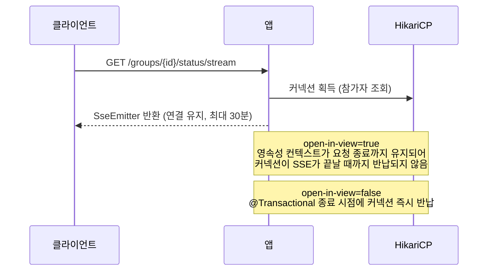
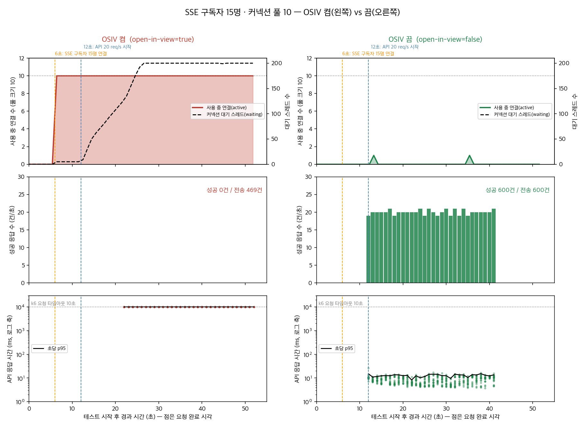

# 트러블슈팅 · 문제 해결 사례

학생 대상으로 실서비스를 운영하며 겪은 장애·버그를 **증상 → 원인 규명 → 해결과 선택 근거 → 결과·한계** 순서로 정리했습니다. 사례마다 담당자와 커밋을 남겨 `git show <hash>`로 근거를 확인할 수 있습니다.

> **분석의 근거**: 코드, 커밋 기록, Spring·JPA의 동작 방식에 근거한 설명입니다. 장애 당시 풀 사용량 같은 지표를 따로 수집해 두지는 않았습니다. 그래서 **가장 중요한 사례(1-1 OSIV)는 원인 메커니즘을 로컬에서 재현해 수치로 검증**했고([부하 테스트 보고서](loadtest/README.md)), 나머지 사례의 "구조상 이렇게 된다"는 설명은 아직 코드 근거에 머뭅니다. 또한 "대안과 비교" 항목은 당시 검토 기록이 아니라 **사후 분석**입니다.

## 한눈에 보기

| # | 문제 | 근본 원인 | 해결 | 영역 | 담당 |
| --- | --- | --- | --- | --- | --- |
| 1 | SSE 구독자가 늘수록 DB 커넥션 풀 고갈 | OSIV가 영속성 컨텍스트·커넥션 수명을 **요청 전체**에 묶음. 끝나지 않는 SSE 요청이 커넥션을 계속 점유 | `open-in-view=false`로 수명을 트랜잭션 경계로 복귀 | JPA · 커넥션 풀 | 곽동욱 |
| 2 | SSE 하트비트가 연쇄 지연될 수 있는 구조 | 스케줄러 기본 스레드 1개에서 순차 전송 | 스케줄러 풀 10개 | 스레드 모델 | 곽동욱 |
| 3 | SSE 요청의 에러 응답이 깨지고 연결이 끊김 | `Accept: text/event-stream`과 JSON 응답 간 콘텐츠 협상 실패 | 응답을 직접 기록해 협상 우회 | Spring MVC | 곽동욱 |
| 4 | SSE 종료 때마다 인증 실패 로그 | `ASYNC` 재디스패치에서 SecurityContext가 비어 있음 | 해당 경로의 ASYNC 디스패치 재검사 제외 | Spring Security | 김대현 |
| 5 | 모바일에서 로그아웃·탈퇴가 항상 실패 | 일부 모바일 브라우저가 `SameSite=None` 쿠키를 저장하지 않음 | `Authorization` 헤더 우선, 쿠키 폴백 | 인증 · 브라우저 | 곽동욱 |
| 6 | 인증 실패 사유가 하나로 뭉개짐 | 필터가 알고 있는 사유를 진입점에 전달하지 않음 | 사유를 요청 속성으로 전달, 진입점이 코드 분기 | 인증 · API 설계 | 곽동욱 |
| 7 | 탈퇴한 계정의 토큰으로 요청하면 500 | 필터가 `UsernameNotFoundException`을 처리하지 않음 | 인증 실패(401)로 통일 | 인증 | 곽동욱 |
| 8 | 관리자가 비공개 프로필을 조회하면 403 | 인가 조건에 HOST 예외 누락 | 조건 추가 | 인가 | 곽동욱 |
| 9 | 소셜 계정으로 비밀번호 재설정 메일 발송 | 정책 검사가 **마지막 단계에만** 있음 | 첫 단계로 이동(fail-fast) + 탈퇴 계정 제외 | 보안 · 정책 | 곽동욱 |
| 10 | 저장형 XSS 가능성 | 사용자 입력 무검증 저장 | `<`·`>` 입력 차단(Bean Validation) | 보안 | 곽동욱 |
| 11 | 동시 조 편성 요청 시 데이터 충돌 | 같은 그룹 작업의 직렬화 부재 | 그룹 행 비관적 락 | 동시성 | 김대현 |
| 12 | 그룹 범위 API마다 SELECT 2회 | 그룹·참가자를 따로 조회 | fetch join 1회 + 실패 경로에서만 분기 | 쿼리 최적화 | 김대현 |
| 13 | 그룹 삭제 시 FK 위반 | 차단 기록 행이 남음 | 삭제 시 함께 정리 | 데이터 정합성 | 김대현 |

---

## 1. SSE 도입 직후 연쇄 장애

그룹 상태를 SSE로 실시간 푸시하는 기능을 붙인 직후, 시연 중 동시 접속이 몰리면서 서로 다른 층위(Spring MVC · JPA · 스레드 모델 · Security)의 문제가 연달아 드러났습니다. 한 번에 고치지 않고 **증상 완화와 근본 원인 해결을 분리**해서 하나씩 걷어냈습니다.

### 1-1. 장기 연결이 DB 커넥션 풀을 고갈시킨 문제 — OSIV 원인 규명

**담당** 곽동욱 · **커밋** `d924e6d`(증상 완화) → `b135c2c`(근본 해결) · **일시** 2026-09-03 ~ 09-04

**증상**
시연 중 동시 접속이 몰리자 DB 커넥션이 바로 고갈됐습니다(당시 설정 주석에 기록). 풀이 비면 로그인·조회 같은 SSE와 무관한 요청도 커넥션을 얻지 못하므로 서비스 전체가 느려집니다.

**1단계: 증상 완화**
HikariCP `maximum-pool-size`를 기본 10에서 20으로 증설(`d924e6d`). 당장은 버텼지만, 풀 증설이 해결책인지는 **무엇이 커넥션을 쥐고 있는지**에 달려 있었습니다. 풀이 모자란 것인지, 커넥션이 반납되지 않는 것인지를 가려야 했고, SSE는 요청 자체가 끝나지 않는 기능이라 후자를 의심해 볼 만했습니다.

**2단계: 원인 규명**
`spring.jpa.open-in-view`의 기본값(true)이 원인이었습니다.

- OSIV는 LAZY 로딩을 뷰(직렬화) 단계에서도 쓸 수 있게 **영속성 컨텍스트와 그에 물린 DB 커넥션의 수명을 `@Transactional` 메서드가 아니라 HTTP 요청 전체**에 맞춥니다.
- 일반 요청은 수십~수백 ms 안에 끝나 이 초과분이 보이지 않습니다.
- 그러나 SSE 구독(`SseEmitter` 반환)은 클라이언트가 붙어 있는 내내(최대 30분) 요청이 끝나지 않은 상태입니다. 서비스 메서드가 곧바로 리턴해도 커넥션이 반납되지 않으므로, **동시 구독자 수만큼 커넥션이 고정 점유**됩니다.
- 따라서 풀 크기가 10이면 동시 구독자 10명, 20이면 20명에서 풀이 소진됩니다. 풀 증설은 한계를 조금 미룰 뿐 **구독자 수에 선형으로 비례하는 구조 자체**는 그대로입니다.

**해결과 선택 근거**

| 대안 | 평가 |
| --- | --- |
| 풀 크기만 계속 증설 | 구독자 수에 선형 비례. DB 최대 커넥션·메모리 한계가 있고 원인을 가림 (1단계에서 이미 시도, 근본 해결 아님) |
| SSE 경로만 예외 처리 | OSIV는 전역 인터셉터라 경로별 제어가 번거롭고, 같은 함정이 다른 장기 응답에도 남음 |
| **`open-in-view=false`** (선택) | 커넥션 수명을 트랜잭션 경계에 되돌려 구독자 수와 무관해짐. 설정 한 줄 |

- 이제 `subscribeStatus`는 `@Transactional(readOnly = true)` 안에서 필요한 조회를 끝내고 커넥션을 즉시 반납한 뒤, 만들어 둔 `SseEmitter`만 응답으로 들고 있습니다.
- **부작용 검토**: OSIV를 끄면 트랜잭션 밖의 LAZY 접근이 `LazyInitializationException`이 됩니다. 엔티티 → DTO 변환이 서비스 트랜잭션 안에서 끝나는 구조라서, 끈 뒤 LAZY 초기화 오류로 인한 후속 수정 커밋은 확인되지 않습니다.

**재현 실험으로 검증** (2026-11-19, 로컬 격리 환경, 상세·재현 방법은 [부하 테스트 보고서](loadtest/README.md))

SSE 구독자 N명을 붙여 둔 채 SSE와 무관한 일반 API(`GET /groups?scope=me`)를 초당 20건 호출해, OSIV와 풀 크기만 바꿔 비교했습니다.

| 설정 | SSE 구독자 | 일반 API 성공률 | p95 |
| --- | --- | --- | --- |
| OSIV 켬 · 풀 10 (장애 당시) | 15명 | **0%** | 10초(타임아웃) |
| OSIV 켬 · 풀 20 (1차 완화) | 15명 / 30명 | 100% / **0%** | 13ms / 10초 |
| OSIV 끔 · 풀 10 | 15명 / 30명 | 100% / 100% | 14ms / 12ms |
| OSIV 끔 · 풀 20 (현재) | 15명 / 30명 | 100% / 100% | 13ms / 12ms |

- 구독자 수가 풀 크기 이상이 되는 순간 일반 API가 전부 실패했고(서버 로그: `Connection is not available ... (total=10, active=10, idle=0, waiting=198)`), 이때 Tomcat 워커 스레드 200개가 모두 커넥션을 기다렸습니다.
- **풀 증설(1차 완화)은 무너지는 지점을 15명 → 30명으로 옮기기만** 했습니다. 구조(구독자 수에 비례한 점유)는 그대로였습니다.
- OSIV를 끄자 같은 구독자에서도 사용 중 연결이 0~1에 머물렀고, 구독자 0명일 때와 응답 시간이 같아 **성능 손해도 없었습니다.**

**한계**: 장애 당시 환경을 그대로 되살린 것이 아니라 메커니즘을 격리해 재현한 실험입니다. 운영 EC2에서 **몇 명**에서 무너지는지(풀 크기가 임계 인원을 정함)와 실제 동시 구독자 수는 아직 모릅니다. 측정은 한 대의 맥북에서 케이스당 1회(전체 2회 반복, 판정 12/12 일치)이며, 이 실험을 하며 찾아 고친 **측정 오류 7건**도 보고서에 기록했습니다.

**배운 점**: 프레임워크 기본값은 짧은 요청을 가정합니다. **오래 열려 있는 응답(SSE·스트리밍)** 을 도입할 때는 커넥션·스레드 같은 공유 자원의 수명이 요청 수명과 어떻게 묶여 있는지부터 점검해야 합니다.

### 1-2. 하트비트 스케줄러 스레드 부족

**담당** 곽동욱 · **커밋** `b135c2c`

- **원인**: Spring 스케줄러의 기본 스레드 풀이 1개라, 20초 주기 하트비트가 한 스레드에서 **구독자마다 순차 전송**됩니다. 죽은 연결 하나에서 전송이 막히면 나머지 구독자의 하트비트까지 함께 지연됩니다.
- **해결**: `spring.task.scheduling.pool.size: 10`으로 스케줄러 풀을 늘려 한 연결의 지연이 전체로 번지지 않게 했습니다.
- **연관 설계**: 하트비트 주기(20초)는 클라이언트 라이브러리의 유휴 타임아웃(가장 짧은 것이 45초)보다 짧게 잡았습니다([group-lifecycle.md](group-lifecycle.md#sse-실시간-상태-푸시)).

### 1-3. SSE 요청의 에러 응답이 콘텐츠 협상에 실패

**담당** 곽동욱 · **커밋** `9f29afc`

- **증상**: SSE 구독 중 예외가 나면 에러 응답이 제대로 내려가지 않고 연결이 지저분하게 끊김.
- **원인**: SSE 요청은 `Accept: text/event-stream`으로 들어옵니다. 전역 예외 핸들러가 `ResponseEntity`로 JSON을 돌려주면 Spring이 Accept 헤더와 JSON 사이에서 콘텐츠 협상을 하다 `HttpMediaTypeNotAcceptableException`을 던집니다.
- **해결**: 핸들러가 `HttpServletResponse`에 직접 JSON을 써서 협상 자체를 건너뜁니다([GlobalExceptionHandler](../src/main/java/com/mixmate/exception/GlobalExceptionHandler.java)).
- **트레이드오프**: 반환 타입 기반의 편의(메시지 컨버터)를 포기하는 대신 어떤 `Accept`로 들어와도 에러 본문이 일정하게 내려갑니다.

### 1-4. SSE 종료 시 ASYNC 재디스패치 인증 실패

**담당** 김대현 · **커밋** `0e46138`

- **증상**: SSE 연결이 끝날 때마다 인증 실패 에러 로그가 쌓임.
- **원인**: 연결이 끝나면 같은 요청이 `ASYNC`로 재디스패치되는데, 이때는 SecurityContext가 비어 있어 인증에 실패합니다. 응답은 이미 나간 뒤라 처리할 방법도 없고 로그만 쌓입니다.
- **해결**: 최초 요청에서 이미 인증을 마쳤으므로, 해당 경로(`GET /api/v1/groups/*/status/stream`)의 `ASYNC` 디스패치만 인증 재검사에서 제외([SecurityConfig](../src/main/java/com/mixmate/config/SecurityConfig.java)). 다른 경로는 그대로 인증을 요구합니다.

---

## 2. 인증 · 인가

### 2-1. 모바일에서 로그아웃·회원탈퇴가 항상 실패

**담당** 곽동욱 · **커밋** `5965185` · 2026-09-06

- **증상**: 일부 모바일 환경에서 로그아웃·탈퇴가 서버에 반영되지 않고 항상 `UNAUTHORIZED`.
- **원인**: 두 API가 요청 **쿠키**의 `accessToken`만 읽었습니다. 프론트(Vercel)와 백엔드가 서로 다른 도메인이라 쿠키가 `SameSite=None`이어야 하는데, 일부 모바일 브라우저는 크로스도메인 쿠키를 저장하지 않아 쿠키 자체가 비어 있었습니다.
- **해결**: 토큰 추출을 공통 메서드(`JwtUtil.resolveToken`)로 모아 **`Authorization: Bearer` 헤더를 우선, 없으면 쿠키로 폴백**. 로그인 응답은 토큰을 바디와 쿠키 둘 다로 내려줍니다.
- **트레이드오프**: 헤더 방식은 프론트가 토큰을 JS에서 보관해야 하므로 HttpOnly 쿠키가 주는 XSS 방어를 일부 포기합니다. 쿠키 폴백을 남겨 쿠키가 동작하는 환경에서는 기존 방식이 유지되고, XSS 입력 차단([2-6](#2-6-저장형-xss-차단))으로 이를 보완합니다.

### 2-2. 인증 실패 사유가 하나로 뭉개지던 문제

**담당** 곽동욱 · **커밋** `7c63f3c` · 2026-09-05

- **증상**: 토큰 만료, 로그아웃된 토큰(블랙리스트), 파싱 실패가 모두 `UNAUTHORIZED` 하나로만 응답되어 프론트가 "다시 로그인" 같은 사유별 안내를 할 수 없었음.
- **원인**: JWT 필터는 실패 사유를 알고 있지만, 인증 진입점(`AuthenticationEntryPoint`)에는 그 정보를 넘기지 않았습니다. 필터와 진입점이 서로 다른 단계라 예외가 전달되지 않습니다.
- **해결**: 필터가 사유를 `request` 속성에 담고, 진입점이 이를 읽어 `BLACKLIST_TOKEN` / `JWT_TOKEN_PARSING_ERROR` 등 해당 코드로 응답. 사유가 없을 때(토큰 없음)만 `UNAUTHORIZED`가 기본값([auth.md](auth.md#인증-실패-응답)).
- **효과**: 클라이언트가 `message`가 아닌 **안정적인 `code`로 분기**할 수 있는 계약이 생겼습니다.

### 2-3. 탈퇴한 계정의 토큰으로 요청하면 500

**담당** 곽동욱 · **커밋** `a370bbb` · 2026-09-14

- **증상**: 탈퇴 처리 후 아직 만료되지 않은 토큰으로 요청하면 500.
- **원인**: JWT는 **서명이 유효하면 만료 전까지 유효**합니다. 필터가 계정을 조회하는데 탈퇴한 계정은 `UsernameNotFoundException`을 던지고, 필터가 `JwtException`/`IllegalArgumentException`만 잡고 있어 이 예외가 필터를 뚫고 나갔습니다.
- **해결**: 같은 분기에서 `UsernameNotFoundException`도 잡아 `JWT_TOKEN_PARSING_ERROR`(401)로 통일.
- **배운 점**: stateless 토큰은 "토큰이 유효한 것"과 "계정이 존재하는 것"이 별개입니다. 탈퇴·정지 같은 서버 측 상태 변화가 토큰 검증 경로에서 예외 없이 인증 실패로 수렴하는지 점검해야 합니다. (탈퇴 요청에 쓴 access 토큰은 블랙리스트에도 올려 즉시 무효화합니다. 다른 기기에서 발급된 토큰은 만료 전까지 이 경로에서 401로 수렴합니다.)

### 2-4. 관리자가 비공개 프로필을 조회하면 403

**담당** 곽동욱 · **커밋** `bd9d8f7` · 2026-09-05

- **증상**: 모임장(HOST)이 관리 목적으로 비공개(`PRIVATE`) 참가자 프로필을 조회하면 403.
- **원인**: 허용 조건이 "본인이거나 공개 프로필"뿐이었습니다. 조회 정책에 역할(Role) 축이 빠져 있었습니다.
- **해결**: 조건을 `!isSelf && !isHost && PRIVATE`일 때만 거부로 변경하고, 회귀 방지 테스트를 추가(`ParticipantServiceProfileVisibilityTest`).

### 2-5. 소셜 로그인 계정의 비밀번호 재설정 — 정책은 "마지막"이 아니라 "맨 앞"에서 강제한다

**담당** 곽동욱 · **커밋** `1d4c3f1`(2026-09-14) → `1f73c38`(2026-09-16) · **테스트** `PasswordResetEmailServiceTest`

- **문제**: 소셜 계정은 비밀번호가 없는데 이메일 인증만 통과하면 재설정할 수 있었습니다. 막지 않으면 카카오·구글 전용 계정에 **비밀번호 로그인 수단이 몰래 생겨**, "같은 이메일이면 자동 연동하지 않는다"는 계정 정책과 앞뒤가 맞지 않습니다.
- **1차 해결**: 최종 단계(`/password/reset`)에서 `isLocal()`을 검사해 소셜 계정을 차단.
- **남은 구멍**: 앞 두 단계(인증번호 발송·검증)는 계정 종류와 무관하게 통과했습니다. 소셜 계정 이메일로도 **인증 메일이 실제로 발송**되고, 사용자는 인증을 다 마친 뒤 마지막에야 실패를 봅니다. 불필요한 메일 발송과 나쁜 UX입니다.
- **2차 해결**: 같은 검사를 **인증번호 발송 단계 맨 앞**으로 이동했습니다. 발송 전에 막히므로 메일이 나가지 않고, 저장된 인증번호가 없어 검증 단계도 자연히 실패합니다. 마지막 단계의 검사는 **이중 방어**로 남겼습니다. 조회를 `existsByEmail` 대신 `findByEmailAndDeletedAtIsNull`로 바꿔 탈퇴 계정 이메일로 메일이 나가던 부수 문제도 함께 막았습니다.
- **검증**: 소셜 계정 / 미가입 이메일 / 로컬 계정 세 경우를 단위 테스트로 고정했고, 차단 경로에서 **메일 발송기와 Redis에 어떤 호출도 일어나지 않음**(`verifyNoInteractions`)을 단언해 "메일이 나가지 않는다"는 핵심 요구를 직접 검증합니다.
- **배운 점**: (1) 프론트에서 버튼을 숨기는 것은 UX일 뿐 보안이 아닙니다. 공개 API는 직접 호출될 수 있으므로 정책은 **API 진입 지점에서 fail-fast**로 강제해야 합니다. (2) 다단계 흐름의 정책은 마지막 단계가 아니라 **가장 이른 단계**에서 막아야 부수 효과(메일 발송)가 생기기 전에 끊을 수 있습니다.

### 2-6. 저장형 XSS 차단

**담당** 곽동욱(XSS 차단) · 김대현(길이·이모지 제한) · **커밋** `c442c1d` / `24c9abc`, `b82f405`

- **문제**: 그룹명·설명, 참가자 이름·전공·인스타그램 ID·자기소개가 그대로 저장되어 **다른 참가자 화면에 표시**됩니다. `<script>` 같은 값이 저장되면 저장형 XSS가 됩니다.
- **해결**: 해당 필드에 `@Pattern(regexp = "^[^<>]*$")`를 걸어 `<`·`>`가 포함되면 400으로 거부합니다(전역 핸들러가 공통 에러 형식으로 응답). 문자열 길이 제한과 이모지 차단, DB 컬럼 길이 제한이 함께 적용되어 입력 표면을 줄였습니다.
- **한계와 판단**: 입력 차단은 **출력 시 이스케이프를 대체하지 못합니다.** 블랙리스트(문자 차단)는 우회 가능성이 있으므로 프론트가 값을 텍스트로만 렌더링하는지(HTML 삽입 금지)를 함께 지켜야 하는 다층 방어의 한 층입니다.

---

## 3. 동시성 · 정합성 · 성능

### 3-1. 동시 조 편성 요청 레이스 — 그룹 행 비관적 락

**담당** 김대현 · **커밋** `e8c257a` · 2026-09-10

- **문제**: 관리자가 두 창에서 동시에 편성을 실행하면, 서로의 조원을 지우고 다시 넣다가 **유니크 제약**(assignment, participant)에 걸립니다. 확정 도중에 다른 편성이 실행되면 이미 확정된 라운드의 편성이 바뀌기도 합니다.
- **해결**: 실행·확정이 같은 그룹 행에 `PESSIMISTIC_WRITE` 락(`findWithLockByGroupId`)을 잡고 시작해 **그룹 단위로 직렬화**합니다.
- **디테일**: 락은 그룹을 읽기 **전에** 잡아야 합니다. 그룹을 먼저 읽어 두면 잠근 뒤에도 하이버네이트가 그 상태를 갱신하지 않아 낡은 값으로 판단하게 됩니다(코드 주석으로 순서 제약을 남김).
- **대안과 비교**: 낙관적 락은 충돌 시 재시도 처리가 필요한 반면, 이 작업은 충돌 빈도가 낮고(관리자 소수의 수동 조작) 충돌 비용이 큰(조원 전체 삭제·재삽입) 쪽이라 단순한 비관적 락이 적합했습니다. 유니크 제약은 마지막 방어선으로 그대로 둡니다.
- **한계**: 락 대기 중에도 트랜잭션이 DB 커넥션을 쥐므로, 같은 그룹에 요청이 폭주하면 풀을 점유할 수 있습니다. 관리자 전용 API라 현재 위험은 작습니다.

### 3-2. 그룹 범위 API의 SELECT 2회 → 1회

**담당** 김대현 · **커밋** `78097ab` · 2026-09-04

- **문제**: 그룹 범위 API 대부분이 공통 검증에서 "그룹 조회 → 그 그룹의 참가자 조회"로 **요청당 SELECT를 두 번** 냈습니다.
- **해결**: 참가 정보와 그룹을 **fetch join 한 번**으로 가져오도록 통합(`findWithGroupByGroupIdAndUserId`). 정상 경로는 SELECT 한 번입니다.
- **설계 포인트**: 결과가 비었을 때 "그룹이 없음(404)"과 "참가자가 아님(403)"을 구분해야 하므로, **실패 경로에서만** 그룹 존재 여부를 추가로 확인합니다. 흔한 경로를 최적화하고 드문 경로에 비용을 미루는 방식입니다.
- **주의점**: `Participant.user`는 여전히 LAZY라 `getUser()`는 트랜잭션 안에서만 안전합니다(메서드 주석에 명시).

### 3-3. 그룹 삭제 시 외래 키 위반

**담당** 김대현 · **커밋** `0e34d55` · 2026-08-28

- **문제**: 차단 기능(`group_ban`) 추가 후 그룹을 삭제하면 차단 기록 행이 남아 외래 키 위반.
- **해결**: 그룹 삭제 때 해당 그룹의 차단 기록도 함께 삭제. 모임 종료 시에도 차단 기록을 정리합니다.
- **교훈**: 새 테이블이 기존 엔티티를 참조하면 **기존 삭제 경로가 영향받는지**를 함께 점검해야 합니다.

---

## 4. 이 사례들에서 정리한 원칙

1. **증상 완화와 근본 해결을 분리해서 기록한다.** 풀 증설(완화) 이후에도 "무엇이 커넥션을 쥐는가"를 끝까지 추적해 OSIV(근본)를 찾았습니다.
2. **공유 자원(커넥션·스레드)의 수명을 요청 수명과 분리해서 본다.** SSE처럼 요청이 길어지는 기능은 기본값이 깨지는 지점입니다.
3. **정책은 가장 앞단에서 강제한다.** 프론트 분기는 UX, 보안은 API 진입 지점에서 fail-fast + 이중 방어.
4. **실패 사유를 계약으로 만든다.** 안정적인 에러 `code`를 정의하고 모든 실패 경로가 그 코드로 수렴하게 한다.
5. **고친 것은 테스트로 고정한다.** 특히 "무엇이 일어나지 않아야 하는가"(메일 미발송)를 단언한다.
